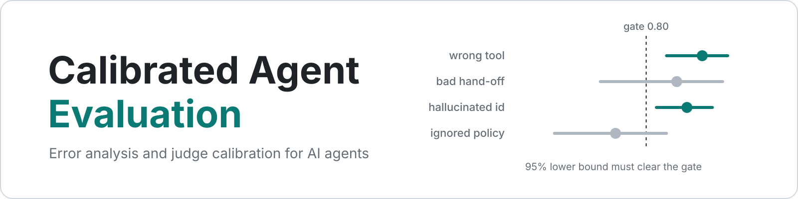
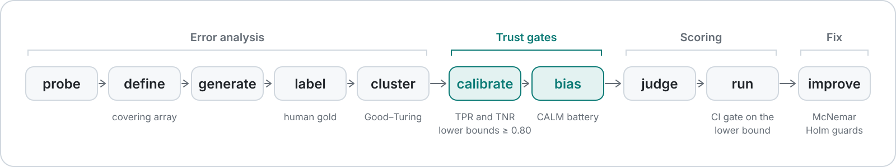

<p align="center">
  <picture>
    <source media="(prefers-color-scheme: dark)" srcset="docs/site/content/assets/readme/banner-dark.svg">
    
  </picture>
</p>

<h3 align="center">Find out how often your AI agent fails, with a number you can defend.</h3>

<p align="center">
  <a href="https://pypi.org/project/calibrated-agent-evaluation/"></a>
  <a href="https://pypi.org/project/calibrated-agent-evaluation/"></a>
  <a href="https://github.com/awslabs/calibrated-agent-evaluation/actions/workflows/ci.yml"></a>
  <a href="LICENSE"></a>
</p>

<p align="center">
  <a href="https://awslabs.github.io/calibrated-agent-evaluation/">Documentation</a> ·
  <a href="https://awslabs.github.io/calibrated-agent-evaluation/getting-started/quickstart/">Quickstart</a> ·
  <a href="https://awslabs.github.io/calibrated-agent-evaluation/guides/lifecycle/">Lifecycle guide</a> ·
  <a href="https://awslabs.github.io/calibrated-agent-evaluation/cli/">CLI reference</a> ·
  <a href="CONTRIBUTING.md">Contributing</a>
</p>

---

An LLM judge reports that 12% of your agent's runs fail. How wrong is the judge, and how wide is
that 12% once you count its mistakes? Calibrated Agent Evaluation answers both questions. It takes
your agent's traces through error analysis, certifies a judge against human labels, corrects the
measured failure rate for the judge's own error, and gates CI on the interval's lower bound.

It grades what the agent did (a normalized trace), so a custom loop, an LLM with MCP tools, a
Strands agent and a multi-agent crew all go through the same pipeline. It is a library and CLI you
run yourself, offline on a laptop or inside a corporate network. There is no hosted service.

## What it checks that a raw judge score skips

- **Judge certification.** A judge is certified only when the 95% lower bounds on both its
  true-positive and true-negative rates reach 0.80, measured on gold labels that are used once.
- **Corrected failure rates.** The judge's measured rate is corrected for its error
  (Rogan–Gladen), with an interval that carries the uncertainty of the human gold and the judge.
  The correction is refused when the judge is too close to chance.
- **Enough labels.** Good–Turing coverage tells you when labeling has stopped finding new failure
  modes, and a planner sizes the gold set and the CI sample before you start.
- **Fixes that held.** A fix is accepted against a target registered before the change, with
  McNemar tests and a Holm-corrected panel of guard metrics.
- **Crews.** In a multi-agent run, the span that caused a failure is kept apart from the span
  where it showed.

It does not label traces for you (a human writes the gold) and it never gates on subjective
qualities such as tone. `calibrated-agent-evaluation prefer` ranks those instead.

## Install

```bash
pip install calibrated-agent-evaluation
```

Or `uv add calibrated-agent-evaluation`, or `uv tool install calibrated-agent-evaluation` for the
CLI alone. Python 3.11.5 or later. The base install depends only on pydantic. Everything that needs
a third-party package is an opt-in extra:

```bash
pip install "calibrated-agent-evaluation[ui,stats,langfuse]"
```

| Extra       | Adds                                                                  |
| ----------- | --------------------------------------------------------------------- |
| `ui`        | the trace-review web app for human labeling                           |
| `stats`     | judge calibration, corrected rates and failure-mode clustering        |
| `langfuse`  | Langfuse as the trace store                                           |
| `inspect`   | Inspect AI logs, agents and judge models                              |
| `strands`   | running and capturing Strands agents                                  |
| `bedrock`   | Amazon Bedrock input generation and embeddings                        |
| `agentcore` | the Amazon Bedrock AgentCore plug-in                                  |

`calibrated-agent-evaluation doctor` lists what is installed. The full set is in the
[installation guide](https://awslabs.github.io/calibrated-agent-evaluation/getting-started/installation/).

## Quickstart

The bundled sample corpus runs end to end in a temporary directory, with no keys or network:

```console
$ calibrated-agent-evaluation quickstart
Seeded 6 agent traces + 9 gold labels into an offline local store

First-pass result: 5 of 6 traces have a labeled failure.
Failure modes found:
    - trusted_broken_policy_tool: 2
    - dropped_material_fact: 1
    - misread_amount: 1
    - vacancy_threshold_margin_mishandled: 1
```

`calibrated-agent-evaluation quickstart --certify` goes further. It seeds 848 traces and writes a
judge kit with recorded model replies, then prints the commands that certify the judge, run its
bias battery and gate CI, all offline. Then bring your own traces from
OpenTelemetry (OpenInference or OpenLLMetry), Inspect AI, Strands, Langfuse, JSONL or Parquet:
[choose your integration path](https://awslabs.github.io/calibrated-agent-evaluation/integrate/).

## How it works

<p align="center">
  <picture>
    <source media="(prefers-color-scheme: dark)" srcset="docs/site/content/assets/readme/pipeline-dark.svg">
    
  </picture>
</p>

Each stage is one subcommand, run in this order. Error analysis comes first: you look at real
traces, label them, and name the failure modes before anything is scored. A judge then has to pass
both trust gates before `judge` will run it, and `run` fails the build when a failure mode's
pass-rate 95% lower bound falls below the threshold. The
[stage map](https://awslabs.github.io/calibrated-agent-evaluation/concepts/stage-map/) covers each
stage, and
[how the numbers work](https://awslabs.github.io/calibrated-agent-evaluation/concepts/how-the-numbers-work/)
explains the statistics, with every method cited.

## Skills plugin

`skills/` is a Claude Code and Kiro plugin that helps a coding agent drive the pipeline: it drafts
the taxonomy, the judge prompt or the review session, then hands off to the CLI command that
enforces the gate. Load it for one session with `claude --plugin-dir <path-to-checkout>`, or
install it from inside Claude Code:

```text
/plugin marketplace add <path-to-checkout>
/plugin install calibrated-agent-evaluation@calibrated-agent-evaluation
```

For Kiro, see [`skills/README.md`](skills/README.md).

## Documentation

- [Why calibrate](https://awslabs.github.io/calibrated-agent-evaluation/why/) and
  [how it compares with alternatives](https://awslabs.github.io/calibrated-agent-evaluation/why/alternatives/)
- [The lifecycle guide](https://awslabs.github.io/calibrated-agent-evaluation/guides/lifecycle/),
  from defining behavior to gating in production
- [Calibrate a judge](https://awslabs.github.io/calibrated-agent-evaluation/guides/calibrate-a-judge/)
  and [gate a pull request in CI](https://awslabs.github.io/calibrated-agent-evaluation/guides/gate-in-ci/)
- [Methods and citations](https://awslabs.github.io/calibrated-agent-evaluation/concepts/methodology/)
- [Python API](https://awslabs.github.io/calibrated-agent-evaluation/reference/) and
  [CLI](https://awslabs.github.io/calibrated-agent-evaluation/cli/) reference

The project is at 0.1.0. Before 1.0, a minor release may change the API
([versioning policy](https://awslabs.github.io/calibrated-agent-evaluation/versioning/)).

## Contributing

[CONTRIBUTING.md](CONTRIBUTING.md) covers the development setup, the code layout and the checks a
change must pass (`just check`). Coding agents should read [AGENTS.md](AGENTS.md).

## Security

See [CONTRIBUTING](CONTRIBUTING.md#security-issue-notifications) for how to report a security
issue, and [SECURITY.md](SECURITY.md) for the security policy and the security model.

## License

This project is licensed under the Apache-2.0 License. See [LICENSE](LICENSE) and
[NOTICE](NOTICE). Vendored code and third-party fixture data are listed with their copyright
notices and full license texts in [THIRD-PARTY-LICENSES](THIRD-PARTY-LICENSES).
