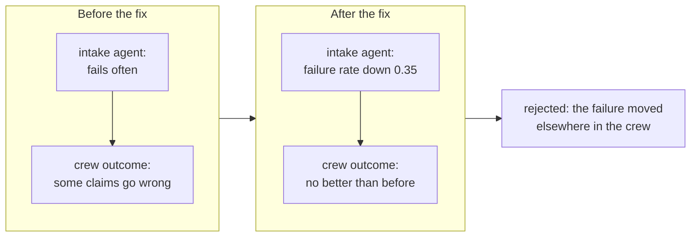

# Did the fix work?

You found a failure mode, changed the agent, and the failure rate went from 45% to 10%. Before you
believe that, rule out two explanations: the difference is luck, or the failure moved somewhere
else. `calibrated-agent-evaluation improve` checks both.

```text
--8<-- "fixtures/expected/docs/example-improve-guard-detail.txt"
```

The two fixes above produce the same numbers on the agent that was changed, and only one is
accepted. The rest of this page explains why.

## Same inputs, before and after

`improve` runs the same inputs through the agent before and after the change, so each input is its
own control. Inputs that passed both times or failed both times say nothing about the fix. Only the
inputs whose outcome changed count: failed before and passed after is evidence for the fix, and
passed before and failed after is evidence against it. In the OrderBot example, 40 held-out inputs
went from 18 failures to 4, and the 14 inputs that changed all went from fail to pass.

The test on those changed inputs is McNemar's test (McNemar 1947). Below 25 changed inputs the test
uses its mid-p form, and above that the standard large-sample form, as Fagerland, Lydersen and
Laake (2013) recommend. The size of the improvement gets a range from Newcombe's interval for paired
data (Newcombe 1998): here the failure rate fell by 0.35.

## Decide what counts as a win before you measure

You register the minimum improvement that counts before the after-run exists:

```text
$ calibrated-agent-evaluation improve --register trusted_broken_policy_tool --min-reduction 0.10
```

The registration is written to a ledger and frozen. Deciding the bar after seeing the result makes
almost any result a win, so a later request with a different bar is refused.

A fix is accepted only when all of these hold:

- the paired test shows the failure rate fell (a two-sided test at the 0.05 level plus a check
  that the change is a fall, which together act like a one-sided test at 0.025),
- the whole range for the improvement clears the registered minimum, so even the least favorable
  end of it is a real improvement,
- no guard slice got worse. Guard slices are other parts of your traffic you want to protect. Several
  slices are checked at once, so their results are corrected together (Holm 1979, at a family-wise
  level of 0.05): with many slices, one would look worse by chance alone.

Two refusals come before any test. A confirmation trace the fix was developed on is refused
(`ConfirmationContaminationError`), and when the verdicts come from a judge, every pair whose
outcome changed needs a human label first (`AdjudicationRequiredError`):

--8<-- "docs/site/content/includes/diagrams/improve-guards.md"

## The failure that moved

For a multi-agent crew there is one more check. In the ClaimsCrew example, a change to the intake
agent cut intake's own failures by the same 0.35. But the crew as a whole did not get better at its
job: its workflow outcome rate did not move, so the failure surfaced somewhere else in the crew
instead of going away. This is called **relocation**. A crew fix is judged on the crew's
end-to-end outcome rate, and a change that only moves the failure from one agent to another is
rejected.

<div class="diagram" markdown>



</div>

[Evaluate a multi-agent crew](../../guides/evaluate-a-crew.md) shows how culprit and manifestation
spans are labeled so this check has something to read.

Next: [error clusters and when to stop labeling](error-clusters.md).
