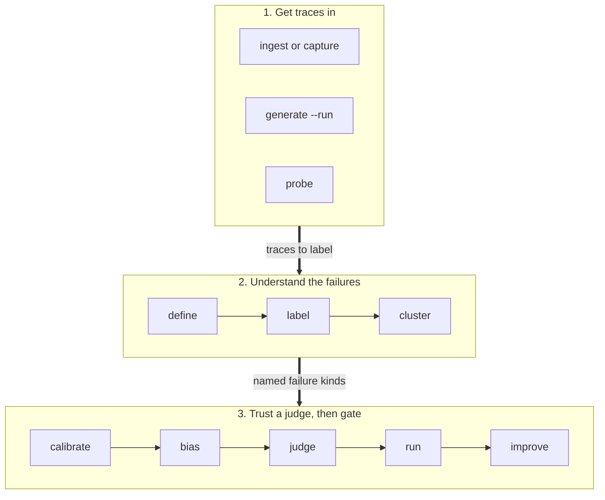

# The stage map

Calibrated Agent Evaluation has one command per stage. Getting traces in comes first; then the
error-analysis stages work out what goes wrong; then the scoring stages put numbers on it and gate
them.

<div class="diagram" markdown>



</div>

If you own your agent, start at `ingest` (or `capture`, or `generate --run` to have the library
choose the inputs) and skip `probe`.

| Stage | What goes in | What comes out | Extra | Library package |
| --- | --- | --- | --- | --- |
| `ingest` / `capture` | trace files or a store you already have, or an in-process run | normalized traces in the store | none for OTLP-JSON and JSONL; `inspect`, `otel`, `datasets` or `hf` for those formats; `strands` for `capture` | |
| `probe` | an endpoint URL and credentials, seed prompts, `--authorized` | outcome-only traces, a capability map (a lower bound), failure hypotheses | `probe`; `probe-ws` for WebSocket | `calibrated_agent_evaluation.probe` |
| `define` | a taxonomy grid, plus your traffic mix for a production frame | frame rows: a cell, its frame, its sampling weight | `sampling` | `calibrated_agent_evaluation.sampling` |
| `generate` | frame rows and a renderer (template or LLM) | one input per row, tagged with its cell; with `--run`, the agent's traces | `sampling` and `stats`; plus `strands` or `inspect` for `--run`, `bedrock` for an LLM renderer, `synth` for `--multi-turn` | `calibrated_agent_evaluation.synth` |
| `label` | traces, one at a time | a gold label per trace: pass or fail, and why | none; `ui` for `--serve` | `calibrated_agent_evaluation.review` |
| `cluster` | labeled failures and their critiques | a codebook of named failure modes, and a saturation verdict | `stats`; `bedrock` for `--embedder` | `calibrated_agent_evaluation.cluster` |
| `calibrate` | a judge and your gold labels | the judge certified, or refused with the reason | `stats` | `calibrated_agent_evaluation.calibrate` |
| `bias` | a certified judge, probes, thresholds | pass, or the irrelevant changes that swayed it | `stats` | `calibrated_agent_evaluation.bias` |
| `judge` | a judge that passed both checks, traces to score | a PASS/FAIL verdict per trace, written back as a score | `stats` | `calibrated_agent_evaluation.judges` |
| `run` | verdicts in the store and a threshold | the CI exit code, plus each mode's corrected rate | `stats` | `calibrated_agent_evaluation.run` |
| `prefer` | an atom set and pairwise preferences on its subjective dimensions | a Bradley–Terry ranking with intervals, tracked and never gated | none | `calibrated_agent_evaluation.subjective` |
| `improve` | a frozen pre-registration and paired before/after outcomes | whether the fix worked, with its evidence | `stats` | `calibrated_agent_evaluation.improve` |

`dump` / `load` export every record to CSV and JSON. See [Integrate](../integrate/index.md) to fill the store, the [CLI reference](../cli/index.md),
and the [Python API reference](../reference/index.md). Each stage calls its package; the CLI never
re-implements the methodology.

## Read this first: error analysis before scoring

The front half (`define`, `label`, `cluster`) names what goes wrong before `judge` and `run` put
numbers on it. `calibrated-agent-evaluation quickstart` seeds the bundled corpus and its gold
labels, whose two agents are the examples below:

- **OrderBot**: a refund agent that trusted a buggy policy tool and refunded an out-of-window return.
- **ClaimsCrew**: a five-agent insurance crew that paid a claim because intake dropped a material fact.

## `probe`: look at an agent you can't see inside

`probe` is for an endpoint with no source and no traces. Its traces hold only what the endpoint
returned. If you own your agent, [ingest existing traces](../integrate/ingest-existing-traces.md)
instead.

## `define`: decide what you're going to evaluate

A **taxonomy** is the grid of situations the agent handles. Each cell is one concrete situation:

```python
TaxonomyGrid(dimensions={
    "feature":  ["refund_handling", "order_status"],
    "scenario": ["S1_in_window_return", "S3_out_of_window_return"],
    "persona":  ["P1_consumer", "P2_reseller"],
})
```

The cell `{feature: refund_handling, scenario: S3_out_of_window_return, persona: P1_consumer}`, a
consumer asking for a refund past the window, is the one OrderBot mishandles. A sampling frame picks which cells to draw from:

| Frame | Draws | Use it for |
| --- | --- | --- |
| **discovery frame** | every pair of dimension values at least once | hunting for failure modes cheaply |
| **production-representative frame** | stratified to your real traffic mix | a failure rate that reflects production |

```python
FrameRow(cell={"feature": "refund_handling", "scenario": "S3_out_of_window_return",
               "persona": "P1_consumer"},
         frame="discovery", weight=1.0)
```

A discovery frame over-samples rare cells on purpose, so a production rate over discovery rows is
refused. See
[`calibrated_agent_evaluation.sampling`](../reference/calibrated_agent_evaluation/sampling/index.md)
(`TaxonomyGrid`, `discovery_frame`, `production_frame`).

## `generate`: turn the frame into concrete inputs

A renderer (an offline template, or an LLM) turns each row into agent input:

```python
SynthInput(
    text="Hi, I'd like to return a blender I bought a couple months ago and get my money back.",
    cell={"feature": "refund_handling", "scenario": "S3_out_of_window_return", "persona": "P1_consumer"},
    frame="discovery",
)
```

With `--run`, each input goes through your real agent (Strands or Inspect) and every output in the
trace is the agent's own. See [route your agent through](../integrate/route-your-agent.md)
(`calibrated_agent_evaluation.synth.generate`, `generate_and_run`).

## `label`: a human decides what actually went wrong

A person reads a trace in the [review UI](../guides/review-traces.md) and records a **gold
label**: pass or fail, and why, in their own words. Judges are calibrated against these.

??? note "A real gold label: OrderBot's over-refund"

    ```json title="ORD-1001 gold label (fixtures/labels/gold.json, selected fields, critique cut short)"
    {
      "trace_id": "ORD-1001",
      "kind": "human",
      "outcome": "FAIL",
      "critique": "Refund of $89.99 issued on an out-of-window return. [...]",
      "failure_mode": "trusted_broken_policy_tool",
      "culprit_span": "ORD-1001/orderbot",
      "manifestation_span": "ORD-1001/orderbot"
    }
    ```

A crew label records where a failure started and where it showed up: ClaimsCrew's has
`culprit_span: "CLM-4471/intake"` and `manifestation_span: "CLM-4471/payout"`. That split drives
[crew attribution](../guides/evaluate-a-crew.md).

## `cluster`: group the failures into named modes, and know when to stop

`cluster` groups critiques into a **codebook** of named failure modes, which a human ratifies:

```python
FailureMode(name="trusted_broken_policy_tool",
            description="Agent accepted a tool's verdict that contradicted its own data.",
            example_critiques=("Refund issued on an out-of-window return; 51 > 30 …",))
```

The **saturation verdict** is the stopping rule: if the agent failed again, how likely is it to be
a mode you have already named?

```text
--8<-- "fixtures/expected/docs/calibrated-agent-evaluation-cluster.txt"
```

A mode seen exactly once means there are more you haven't hit. [Error
clusters](how-the-numbers-work/error-clusters.md) explains the estimate
(`calibrated_agent_evaluation.cluster`: `hierarchical_cluster`, `ratify`, `saturation_check`,
`coverage_report`).

## `judge`: score at scale with a calibrated judge

A judge, usually an LLM, scores traces at scale. It refuses to score until it has been
[checked against your gold labels](how-the-numbers-work/checking-a-judge.md) and passed the bias
check. An illustrative verdict for ORD-1002, a correct in-window refund:

```json
{ "trace_id": "ORD-1002", "kind": "llm-judge", "outcome": "PASS",
  "critique": "The return was inside the 30-day window, so issuing the refund was correct." }
```

See [Calibrate a judge](../guides/calibrate-a-judge.md).

## `run`: turn rates into a pass/fail gate

The gate passes only when every failure mode's pass rate clears the bar (80%, or `--threshold`)
even at the pessimistic end of its range. It reads judge verdicts by default, or `--verdicts
scorer` / `--verdicts human`. `--judge FILE` adds each mode's corrected failure rate, or the reason
it was refused. Over the corpus's human labels:

```text
--8<-- "fixtures/expected/docs/calibrated-agent-evaluation-run-ci.txt"
```

See [Gate a PR in CI](../guides/gate-in-ci.md) and, for how many traces a mode needs,
[the CI gate](how-the-numbers-work/ci-gate.md).

## `improve`: prove your fix actually worked

You fix the metric and threshold before measuring, compare before and after on a held-out slice, and
apply a paired test. For a crew it also catches **relocation**, a fix that moves the failure
elsewhere. Here `calibrated-agent-evaluation improve --request` reads 20 paired outcomes (8 failed
before, 3 after) and one guard slice:

```text
--8<-- "fixtures/expected/docs/recipe-improve.txt"
```

??? note "The same verdict with `--explain`"

    ```text
    --8<-- "fixtures/expected/docs/recipe-improve-explain.txt"
    ```

[The improve request file](../recipes/improve-request-file.md) shows the file.
`--evaluate METRIC --before-root A --after-root B` pairs two stores instead. The relocation check
runs from the library: see [Evaluate a multi-agent crew](../guides/evaluate-a-crew.md).

## Next

- [Integrate Calibrated Agent Evaluation into your app](../integrate/index.md): bring your own
  agent's traces.
- [Calibrate a judge](../guides/calibrate-a-judge.md): the gate that stands between `cluster` and `judge`.
- [How the numbers work](how-the-numbers-work/index.md): the stopping rule and the refusals.
