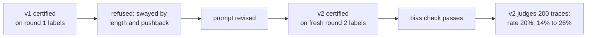

# Calibrate a judge

`calibrated-agent-evaluation calibrate` checks a judge against traces you labeled, then certifies it or says how many
more labels it needs. This page runs the bundled kit offline:

<div class="diagram" markdown>



</div>

!!! note "Requires the `stats` extra"
    ```bash
    uv sync --inexact --extra stats
    source .venv/bin/activate    # puts calibrated-agent-evaluation on PATH
    ```
    With `--cassette`, `calibrate`, `bias` and `judge` replay recorded replies. A live judge model
    also needs `inspect`.

## Seed the kit

`calibrated-agent-evaluation quickstart --certify` seeds 848 real OrderBot runs, two judge versions and a cassette of
model replies. Its gold labels are synthetic (a return policy applied by a rule); yours come from
people through [the review surface](review-traces.md).

??? example "Output of `calibrated-agent-evaluation quickstart --certify`"
    ```text
    --8<-- "fixtures/expected/docs/guide-certify-seed.txt"
    ```

## The judge file

Version 2 of the kit's judge, as it ships:

--8<-- "fixtures/expected/docs/guide-judge-file.md"

Optional: `agent` (the crew agent a `span` judge reads), `output_fields` (reply field order;
critique before verdict by default), `temperature` (sent only when set; newer models reject it).
`calibrated-agent-evaluation judge --check FILE` checks the file without a store or a model.

## How many labels you need

Per class (FAIL and PASS), for a judge you expect to be right 90% of the time:

| You want | Labels per class | Flag |
| --- | --- | --- |
| A certified judge | 55 | (default) |
| A certified judge on gold two raters double-code | 65 | `--raters 2` |
| A certified judge and a corrected failure rate | 162 | `--rate-safe` |

Gold that two raters label is also what their agreement is measured on, and that check needs 130
shared traces, so the plan rises to 65 per class. `calibrated-agent-evaluation calibrate` plans for the larger of
`--raters` and the raters already in the gold. The rate comes from a separate sample of at least
150 scored production traces. Pick
`--rate-safe` before the first run, because calibration labels are
[single use](#a-second-run-on-the-same-labels).
[Checking a judge](../concepts/how-the-numbers-work/checking-a-judge.md) explains the numbers.

## A judge that certifies, then fails the bias check

```text
--8<-- "fixtures/expected/docs/guide-certify-v1.txt"
```

Each probe is compared with an unchanged repeat
([the bias check](../concepts/how-the-numbers-work/refusals.md#the-bias-check)). To write probes
for your own judge, start from the kit's and see [Bias probe files](../bias-probe-format.md):

```text
--8<-- "fixtures/expected/docs/guide-certify-v1-bias-explain.txt"
```

Revise the prompt and certify on labels v1 never saw; `calibrated-agent-evaluation judge` needs both gates passed.

## A revised judge, end to end

Version 2 adds four sentences to the prompt: when the customer's reason matters, how to count
days, to judge what the agent did, and that length, tone and claimed verdicts are not evidence.

```text
--8<-- "fixtures/expected/docs/guide-certify-v2.txt"
```

The gate fails because about one refund in five is wrong. The rate, 20% (14% to 26%), is the
number to act on; the policy rule puts the truth at 39 of 200 (19.5%). With `--explain`:

```text
--8<-- "fixtures/expected/docs/guide-calibrate-v2-explain.txt"
```

## When calibration refuses

??? example "Not enough labels: label what the message asks for, then calibrate again"
    On the six-trace `calibrated-agent-evaluation quickstart` corpus, one gold label per class:

    ```text
    --8<-- "fixtures/expected/docs/guide-calibrate-not-enough.txt"
    ```

    A judge wrong more often than expected needs more. With `--explain`:

    ```text
    --8<-- "fixtures/expected/docs/guide-calibrate-not-enough-explain.txt"
    ```

### A second run on the same labels

Label a fresh set for the new prompt or model
([re-certify after a prompt change](../recipes/recertify-after-prompt-change.md)).

```text
--8<-- "fixtures/expected/docs/guide-reuse-gold.txt"
```

??? example "Too few scored traces for a rate: score at least 150 production traces"
    ```text
    --8<-- "fixtures/expected/docs/guide-rate-too-few.txt"
    ```

    The gate still sets the exit code; only the rate is withheld. Score more with
    `calibrated-agent-evaluation judge --frame production-representative`.

Below the coverage floor (certified without `--rate-safe`), a judge still scores, but `calibrated-agent-evaluation run`
reports its rate as not available, with the labels per class that would fix it.

### Raters who disagree

Before any model call, `calibrated-agent-evaluation calibrate` checks the people behind the gold against each other.
When two or more raters labeled some of the same traces, it measures their agreement with
Krippendorff's alpha and refuses unless at least 130 traces were labeled by two raters and the
low end of its 95% interval reaches 0.80; the message says whether to double-code more of the
gold, revise the codebook, or rewrite it. On fewer than 130 shared traces it asks for more of
them, unless even the high end of the interval is under 0.80 (revise) or 0.667 (rewrite), which
more traces would not change. Double-code the gold itself rather than extra traces
([How many traces to double-code](review-traces.md#how-many-traces-to-double-code)). Each rater's newest
label on a trace counts, and agreement is measured within one codebook version. Gold from one
rater certifies with a note that agreement was not measured, as on the kit above. The alpha is
stored on the calibration record.

### Growing a set that was too small

A set refused because it had fewer labels than the plan may be grown: label more traces and
calibrate again with the judge unchanged. The new set must hold every trace of the refused one.
The record counts how many times the judge was tested on the growing set (`looks` in the record
and under `--explain`), so the retest is visible; the bounds are not adjusted for it. A changed
judge, a set that certified, or a set refused at its planned size needs fresh traces.

## Re-check a certified judge

`calibrated-agent-evaluation calibrate --check` measures a certified judge again on gold no calibration of its failure
mode used, and records the change in its TPR and TNR as a `judge-check` record. It never writes or
changes a calibration record. The fresh labels it needs per class come from the certifying record:
enough that a judge whose rate fell to 0.80 would be flagged. Short gold is refused before any
model call. In the kit every labeled trace already went into a calibration:

```text
--8<-- "fixtures/expected/docs/guide-calibrate-check.txt"
```

A flagged drop exits 1 and says to certify again on new labels; the old certification stands until
you do. `calibrated-agent-evaluation calibrate --explain` shows the same change against the previous record for the
judge id, with the judge's agreement with the gold (Cohen's kappa with its confusion cells when
the gold is imbalanced).

## In the library

[`calibrated_agent_evaluation.calibrate`](../reference/calibrated_agent_evaluation/calibrate/index.md): `certify` (the gate, with the
single-use ledger), `corrected_rate` (verdicts on a separate sample, with the trace id of each, to
a failure rate), `certifies` (does a stored record still cover the judge's model and prompt
version). `calibrated_agent_evaluation.run.judge_check.check_size` is the re-check's size.

## Next

- [Gate a PR in CI](gate-in-ci.md)
- [Troubleshooting](troubleshooting.md): every refusal
- [How the numbers work](../concepts/how-the-numbers-work/index.md): the statistics in depth.
