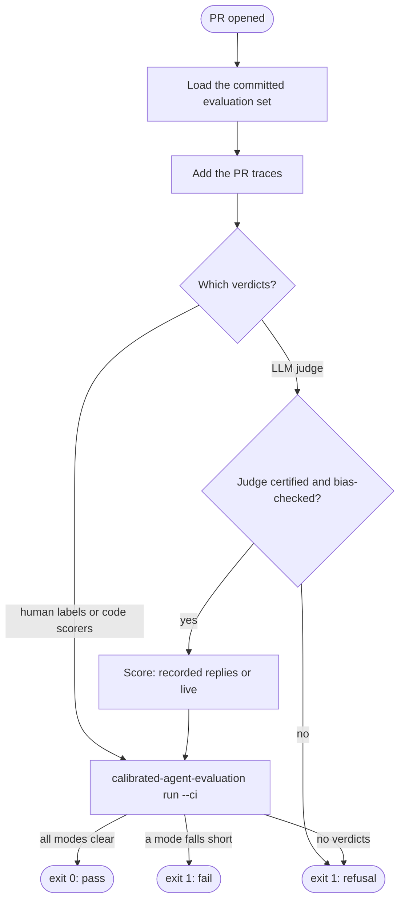

# Gate a PR in CI

`calibrated-agent-evaluation run --ci` exits 0 when every failure mode passes often enough and 1 when one does not,
naming it. Any CI system can use the exit code.

```bash
uv sync --inexact --extra stats
source .venv/bin/activate
calibrated-agent-evaluation --root .calibrated-agent-evaluation quickstart          # seed the six-trace sample corpus into ./.calibrated-agent-evaluation
calibrated-agent-evaluation run --verdicts human --ci
```

On the sample corpus's human labels, every mode fails:

```text
--8<-- "fixtures/expected/docs/calibrated-agent-evaluation-run-ci.txt"
```

## The job



## What passing means

A mode passes when the lowest pass rate consistent with its traces at 95% confidence is at least
80% (`--threshold` changes the bar). Traces needed, from the function the gate calls
(`docs/site/examples/integrate/gate_sample_size.py`):

```text
--8<-- "fixtures/expected/docs/integrate-gate-sample-size.txt"
```

With one or two traces per mode the sample corpus cannot pass. For your own threshold and the
pass rate you expect, `calibrated-agent-evaluation plan --gate` gives the size:

```text
--8<-- "fixtures/expected/docs/guide-plan-gate.txt"
```

[How the numbers work](../concepts/how-the-numbers-work/index.md) explains the bound.

A suite that keeps passing with headroom has stopped telling you much. When every mode clears the
bar by a wide margin run after run, add harder or fresher cases: the failures review found since the
suite was built, recent production traces, or taxonomy cells the suite does not cover yet.

## Verdicts and judge calls

| Flag | Reads | Model calls |
| --- | --- | --- |
| `--verdicts judge` (default) | `calibrated-agent-evaluation judge` verdicts, written only by a [certified](calibrate-a-judge.md) judge | replay or live, below |
| `--verdicts scorer` | code scorers' verdicts | none |
| `--verdicts human` | human labels | none |

A source with no verdicts is refused, never swapped. `--judge FILE` adds each mode's failure rate
corrected for the judge's error. The rate is read from production-representative traces the judge
was not calibrated on: verdicts on hand-picked traces or on its calibration gold are left out with
a note saying how many, and `--explain` lists the gold trace ids. The run record lists the scorer
behind each gated code verdict; under `--ci`, verdicts from a generic generation-quality metric
(ROUGE, BLEU, METEOR, BERTScore, helpfulness) are refused. `--atoms FILE` names which dimensions are objective: a gated mode must be
one of them, and a subjective dimension is refused.

`calibrated-agent-evaluation score` writes code-scorer verdicts: it compares each trace's output with the expected value
a person recorded on a FAIL for the mode, or one from `--expected FILE` (JSONL of `trace_id` and
`expected`). On the sample corpus, with `docs/site/examples/guides/expected-replies.jsonl`:

```text
--8<-- "fixtures/expected/docs/guide-score-exact-explain.txt"
```

The compare-to-expected scorers are `exact`, `levenshtein`, `numeric`, `json-diff` and `valid-json`
(the `scorers` extra). Two more *run* the output instead of comparing its text: `code` runs the
trace's code against the `--expected` tests in a sandbox (local by default, or the AgentCore Code
Interpreter with `--sandbox agentcore`; the local one is best-effort and not a security boundary,
so use `agentcore` for untrusted model output), and `sql` executes the trace's query and the `--expected`
gold query against a seeded SQLite database and compares result sets. Each run with other
parameters is a separate rater in the store.

A judge's model calls are replayed from a cassette or made live:

- Replay, for a fixed regression set: record the judge's replies once with
  `--cassette PATH --cassette-mode record` on `calibrate`, `bias` or `judge`, commit the cassette,
  and pass `--cassette PATH` in the job. Record mode always calls the live model and overwrites any
  reply the cassette already holds. Replay is the default mode: it needs no credentials, and a
  trace the cassette never recorded fails.
- Live, for new PR traces: the `inspect` extra and credentials from the CI secret store (for
  Bedrock, an assumed IAM role, never long-lived keys).

## Seed the job's store

`calibrated-agent-evaluation dump` writes the traces, labels and judge records to a directory you commit; `calibrated-agent-evaluation load`
restores it as the job's first step (`docs/site/examples/integrate/ci_seed_and_gate.py`):

```text
--8<-- "fixtures/expected/docs/integrate-ci-seed-and-gate.txt"
```

`load` checks every file against the sha256 the dump recorded in `dump-manifest.json`, so commit
the directory byte for byte. The CSV files end their lines with CRLF, which git rewrites under
`core.autocrlf` or a `text=auto` rule; a `.gitattributes` line such as `eval-set/** -text` keeps
them as written.

Then `calibrated-agent-evaluation ingest` the PR's traces and `calibrated-agent-evaluation judge --judge FILE` them. Or point
`--backend langfuse` at a project holding the set.

To score with a judge in a job that should not carry the gold, export only the judge: the judge
file with the calibration record and bias battery that admit it. A judge the trust chain would not
admit is refused.

```text
--8<-- "fixtures/expected/docs/guide-dump-judges-only.txt"
```

```text
--8<-- "fixtures/expected/docs/guide-load-judges-only.txt"
```

## Export the numbers

`calibrated-agent-evaluation results --out FILE` writes every stored estimate (bounds, rates, drift, refusals with
their reason) to one CSV, a row each, with the method, level and provenance:

```text
--8<-- "fixtures/expected/docs/guide-results.txt"
```

## Install the package in the job

The job installs the package from PyPI with the `stats` extra the gate needs. Pin the version you
tested against.

=== "GitHub Actions"

    ```yaml
    name: eval-gate
    on: [pull_request]

    jobs:
      evaluate:
        runs-on: ubuntu-latest
        steps:
          - uses: actions/checkout@v4
          - uses: astral-sh/setup-uv@v5
          - run: uv tool install "calibrated-agent-evaluation[stats]==0.1.0"
          - run: calibrated-agent-evaluation load eval-set
          - run: calibrated-agent-evaluation run --ci --verdicts human
    ```

=== "GitLab CI"

    ```yaml
    eval-gate:
      image: ghcr.io/astral-sh/uv:python3.13-bookworm
      script:
        - uv tool install "calibrated-agent-evaluation[stats]==0.1.0"
        - export PATH="$(uv tool dir --bin):$PATH"
        - calibrated-agent-evaluation load eval-set
        - calibrated-agent-evaluation run --ci --verdicts human
    ```

??? tip "Slow start in a crowded CI image"
    Pydantic scans installed packages for plugins on first validation. If the job uses none, set
    `PYDANTIC_DISABLE_PLUGINS=__all__`.

## Exit codes

| Code | Meaning |
| --- | --- |
| 0 | The run finished. With `--ci`, the gate also passed. |
| 1 | With `--ci`, a mode failed the gate. Also any refusal, and a failed `--publish`. |
| 2 | A usage error: an unknown flag or value. |
| 3 | With `--fail-on-drift`, input drift or a stale judge was flagged and the gate did not fail. |

A failing gate under `--ci` exits 1 even when drift is flagged as well, so a job that treats any
non-zero code as a failure needs no special case. A job that wants drift to warn rather than block
can allow exit 3.

## Check drift against the last release

Dump the store when you cut a release, load the dump into its own root, and compare each run with
it:

```text
--8<-- "fixtures/expected/docs/guide-run-drift.txt"
```

Here the baseline is the same traffic, so nothing moved. `--drift-feature` picks what to compare:
`input-chars` (the length of the trace input), `turns` (agent steps) or `tool-calls`. It has no
default. Both sides are the production-representative sample. The mix of taxonomy cells is always
compared too, and is reported without ever flagging.

??? note "The numbers behind the drift check"

    ```text
    --8<-- "fixtures/expected/docs/guide-run-drift-explain.txt"
    ```

Drift never changes the gate. When it is flagged, each judge given with `--judge` and admitted by
its calibration and bias records gets a staleness warning, and `--fail-on-drift` turns either into
exit 3. With too few traces on a side to compare (fewer than 50), the run says so and nothing is
flagged. The [drift recipe](../recipes/drift-check.md) explains the measures.

## Publish to a dashboard

`--publish local` writes the run's corrected rates and drift measures to
`<root>/dashboard/<run_id>/` as CSV and JSON. `--publish langfuse` writes the same files and also
sends each value as a score on a trace named for the run, in the project the `LANGFUSE_*` keys
name, whatever `--backend` is. The run is recorded before the publish starts: if the publish fails,
the job exits 1, prints the gate verdict, and says `Run recorded as <id>; publish failed: ...`.

`calibrated-agent-evaluation calibrate --check` re-measures a judge on fresh labels
([Calibrate a judge](calibrate-a-judge.md#re-check-a-certified-judge)).

Next: [Calibrate a judge](calibrate-a-judge.md), or the [`calibrated-agent-evaluation run` reference](../cli/run.md).
