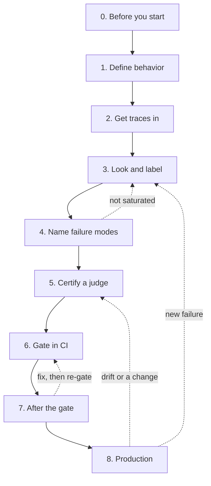

# From first trace to production

This guide takes your agent from its first traces to a gated pull request and a scheduled check in
production. It uses your agent, not a sample one, so every command is written against placeholders
you replace:

| Placeholder | Stands for |
| --- | --- |
| `my_agent:build` | your agent's entry point, as `module:callable` |
| `traces/` | a folder of trace files your agent exported |
| `judges/wrong_refund.json` | a judge file for one failure mode |
| `wrong_refund` | that failure mode's name |
| `alice`, `bob` | the two people who label |

Each phase opens with the Claude Code skill that runs it and then shows the `calibrated-agent-evaluation` commands the
skill drives, so you can follow either way. Under "What you'll see" is output captured from the
command against the bundled sample data when the docs were built.

<div class="diagram" markdown>



</div>

| Phase | Skill | Commands | What you have at the end |
| --- | --- | --- | --- |
| [0. Before you start](0-before-you-start.md) | `audit-eval-pipeline` | `calibrated-agent-evaluation doctor` | roles, a label budget, an install |
| [1. Define behavior](1-define-behavior.md) | `run-error-analysis` | `calibrated-agent-evaluation define` | an expected-behavior spec and an input taxonomy |
| [2. Get traces in](2-get-traces-in.md) | `run-error-analysis` | `calibrated-agent-evaluation ingest`, `capture`, `generate --run` | your agent's runs in a store, each tagged with its frame |
| [3. Look and label](3-look-and-label.md) | `build-annotation-ui` | `calibrated-agent-evaluation label` | human labels, and an agreement check on double-coded traces |
| [4. Name failure modes](4-name-failure-modes.md) | `run-error-analysis` | `calibrated-agent-evaluation cluster`, `cluster --ratify`, `score` | a ratified codebook, and a verdict on whether to keep labeling |
| [5. Build and certify a judge](5-build-and-certify-a-judge.md) | `build-binary-judge`, `validate-judge` | `calibrated-agent-evaluation judge --check`, `calibrate`, `bias` | a judge that may score |
| [6. Gate in CI](6-gate-in-ci.md) | `validate-judge` | `calibrated-agent-evaluation plan --gate`, `judge`, `run --ci` | a pass or fail on every pull request |
| [7. After the gate](7-after-the-gate.md) | `validate-judge` | `calibrated-agent-evaluation results`, `improve` | a merged fix, proven against a bar you set first |
| [8. Run it in production](8-production.md) | `validate-judge` | `calibrated-agent-evaluation ingest --sample`, `run --drift-baseline --publish`, `calibrate --check` | a scheduled rate with its range, drift checks and a re-certification policy |

Phases 0 to 5 happen once per agent and again when the agent changes enough to need it. Phases 6
to 8 run continuously.

If you want to see every stage run before you touch your own agent, run
`calibrated-agent-evaluation quickstart --certify` first ([Quickstart](../../getting-started/quickstart.md)). It seeds
848 real runs of a refund agent and writes a judge kit that replays its judge offline. Many "What
you'll see" blocks in this guide come from that kit, and
[Calibrate a judge](../calibrate-a-judge.md) walks the kit's whole chain.

??? example "Output of `calibrated-agent-evaluation quickstart --certify`"

    <div class="wrap-output" markdown>

    ```text
    --8<-- "fixtures/expected/docs/tutorial-certify.txt"
    ```

    </div>

    The kit's traces are real agent runs; its labels are synthetic, written by a rule that applies
    the store's return policy in place of a reviewer. Your labels come from people.
