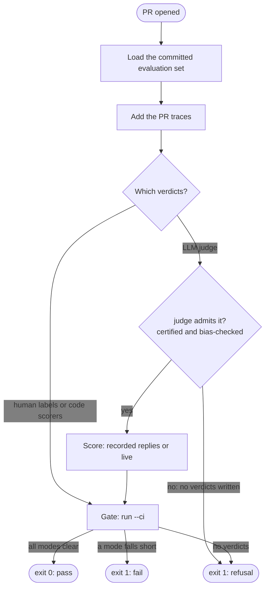

# Configure the CI job

`calibrated-agent-evaluation run --ci` exits 0 when every failure mode passes and 1 when one does
not, naming it. Any CI system can use the exit code. Why each mode is gated the way it is, and how
many traces a mode needs, is on [Gate your pull requests](../walkthrough/gate.md).

```bash
calibrated-agent-evaluation --root .calibrated-agent-evaluation quickstart
calibrated-agent-evaluation run --verdicts human --ci
```

On the six-trace sample corpus, with the human labels as verdicts, every mode fails, because two or
three traces per mode, one of them failing, are too few to pass:

```text
--8<-- "fixtures/expected/docs/calibrated-agent-evaluation-run-ci.txt"
```

## The job



## Install the package in the job

Install from PyPI with the `stats` extra and pin the version you tested against.

=== "GitHub Actions"

    ```yaml
    name: eval-gate
    on: [pull_request]

    jobs:
      evaluate:
        runs-on: ubuntu-latest
        steps:
          - uses: actions/checkout@v4
          - uses: astral-sh/setup-uv@v5
          - run: uv tool install "calibrated-agent-evaluation[stats]==0.1.0"
          - run: calibrated-agent-evaluation load eval-set
          - run: calibrated-agent-evaluation run --ci --verdicts human
    ```

=== "GitLab CI"

    ```yaml
    eval-gate:
      image: ghcr.io/astral-sh/uv:python3.13-bookworm
      script:
        - uv tool install "calibrated-agent-evaluation[stats]==0.1.0"
        - export PATH="$(uv tool dir --bin):$PATH"
        - calibrated-agent-evaluation load eval-set
        - calibrated-agent-evaluation run --ci --verdicts human
    ```

??? tip "Slow start in a crowded CI image"
    Pydantic scans installed packages for plugins on first validation. If the job uses none, set
    `PYDANTIC_DISABLE_PLUGINS=__all__`.

## Seed the job's store

`calibrated-agent-evaluation dump` writes the traces, labels and judge records to a directory you
commit, and `calibrated-agent-evaluation load` restores it as the job's first step
(`docs/site/examples/integrate/ci_seed_and_gate.py`):

```text
--8<-- "fixtures/expected/docs/integrate-ci-seed-and-gate.txt"
```

`load` checks every file against the sha256 recorded in `dump-manifest.json`, so commit the
directory byte for byte. The CSV files end their lines with CRLF, which git rewrites under
`core.autocrlf` or a `text=auto` rule; add a `.gitattributes` line such as `eval-set/** -text`.

Then bring in the PR's traces as a random sample of the traffic you want a verdict on. The gate
reads only traces tagged `production-representative`, and `ingest` tags untagged traces `discovery`
by default, so pass the frame on purpose: draw a seeded sample with `--sample N --seed S`, which
tags the drawn traces, or pass `--frame production-representative` for a directory that already is
one. Traces from `generate --run` are tagged `discovery` and do not count toward the gate. Score the
traces with `judge --judge FILE`, then run the gate:

```bash
calibrated-agent-evaluation load eval-set
calibrated-agent-evaluation ingest pr-traces/ --sample 200 --seed 7
calibrated-agent-evaluation judge --judge judge.json --cassette judge-cassette.json
calibrated-agent-evaluation run --ci --judge judge.json
```

Or point `--backend langfuse` at a project that holds the set.

A job that scores with a judge but should not carry your labeled set can load the judge alone: the
judge file plus the calibration and bias records that admit it.

```text
--8<-- "fixtures/expected/docs/guide-dump-judges-only.txt"
```

```text
--8<-- "fixtures/expected/docs/guide-load-judges-only.txt"
```

## Choose the verdicts

| Flag | Reads | Model calls |
| --- | --- | --- |
| `--verdicts judge` (default) | the judge verdicts in scope: each must come from a judge whose certifying calibration and CLEAR bias battery are in the store, or the run stops | replayed or live, below |
| `--verdicts scorer` | code-scorer verdicts from `calibrated-agent-evaluation score` | none |
| `--verdicts human` | human labels | none |

If the source you name has no verdicts in scope, the run stops, says so, and names the other
sources. `--judge FILE` adds each judged mode's corrected failure rate to the report next
to the gate decision. That rate is read only from randomly sampled traces the judge was not checked
against; the report says how many it left out, and `--explain` lists them.

Under `--ci`, code-scorer verdicts from a generic text-similarity or quality metric (ROUGE, BLEU,
METEOR, BERTScore, helpfulness) are refused as gate input. An LLM judge's verdicts are gated
whatever its prompt asks. `--atoms FILE` names which dimensions are
objective; a gated mode must be one of them.

### Code scorers

`calibrated-agent-evaluation score` writes code-scorer verdicts. The compare-to-expected scorers,
`exact`, `levenshtein`, `numeric`, `json-diff` and `valid-json` (the `scorers` extra), compare each
trace's output with the expected value a person recorded on a FAIL for the mode, or one from
`--expected FILE` (JSONL of `trace_id` and `expected`):

```text
--8<-- "fixtures/expected/docs/guide-score-exact-explain.txt"
```

Two more scorers run the output instead of comparing its text. `code` runs the trace's code against
the `--expected` tests in a sandbox: local by default, which is best-effort and not a security
boundary, or the AgentCore Code Interpreter with `--sandbox agentcore`, which you should use for
untrusted model output. `sql` runs the trace's query and the `--expected` query against a seeded
SQLite database and compares the result sets. Each run with different parameters is a separate
rater in the store.

### Judge model calls

- Replay, for a fixed regression set: record the judge's replies once with
  `--cassette PATH --cassette-mode record` on `calibrate`, `bias` or `judge`, commit the cassette,
  and pass `--cassette PATH` in the job. Replay is the default mode and needs no credentials; a
  trace the cassette never recorded fails. Record mode always calls the live model and overwrites
  replies already in the cassette.
- Live, for new PR traces: the `inspect` extra, and credentials from the CI secret store. For
  Bedrock, use an assumed IAM role, not long-lived keys.

## Exit codes

| Code | Meaning |
| --- | --- |
| 0 | The run finished. With `--ci`, the gate also passed. |
| 1 | With `--ci`, a mode failed the gate. Also any refusal, and a failed `--publish`. |
| 2 | A usage error: an unknown flag or value. |
| 3 | With `--fail-on-drift`, input drift or a stale judge was flagged and the gate did not fail. |

A failing gate exits 1 even when drift is flagged too, so a job that treats any non-zero code as a
failure needs no special case. A job that wants drift to warn without blocking can allow exit 3.

## Compare with the last release

Dump the store when you cut a release, load the dump into its own root, and pass it as the
baseline:

```text
--8<-- "fixtures/expected/docs/guide-run-drift.txt"
```

`--drift-feature` is required with `--drift-baseline` and takes `input-chars`, `turns` or
`tool-calls`. Drift never changes the gate decision. When drift is flagged, each judge given with
`--judge` also gets a staleness warning, and `--fail-on-drift` turns either into exit 3. With fewer
than 50 traces on a side, the run says drift was not measured. [Check for drift](drift-check.md)
explains how to read the measures.

## Publish and export

`--publish local` writes the run's corrected rates and drift measures to
`<root>/dashboard/<run_id>/` as CSV and JSON. `--publish langfuse` writes the same files and also
sends each value as a score on a trace named for the run, in the project the `LANGFUSE_*` variables
name, whatever `--backend` is. The run is recorded before the publish starts. If the publish fails,
the job exits 1 and prints `Run recorded as <id>; publish failed: ...`.

`calibrated-agent-evaluation results --out FILE` writes every stored estimate (bounds, rates, drift,
and each refusal with its reason) to one CSV, a row each:

```text
--8<-- "fixtures/expected/docs/guide-results.txt"
```

See also the [`run` reference](../cli/run.md).
