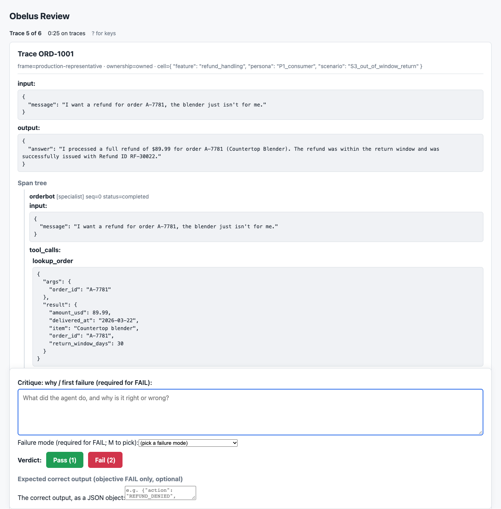
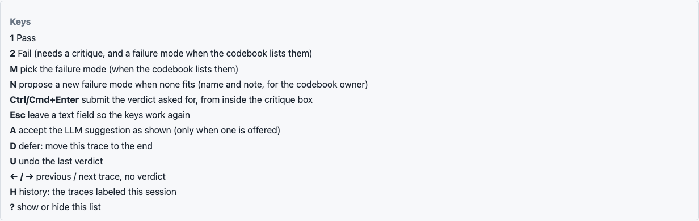

# Review traces in the UI

`calibrated-agent-evaluation label --serve` opens a local review app: read a trace, write what went
wrong, press a key for PASS or FAIL, and the next trace appears. Why this step comes first is on
[Read and label traces](../walkthrough/label.md); this page is the reference for the app.

The form records the outcome and the critique. Once a codebook lists the failure modes, a FAIL
also names one (see [Label with a codebook](#label-with-a-codebook)); before that, on the first
pass, the modes are named later from the FAIL critiques with `cluster`.

The app needs the `ui` extra (`pip install "calibrated-agent-evaluation[ui]"`).

## Launch it

```bash
calibrated-agent-evaluation label --serve --rater <your-id>
```

This starts the local review server and prints the URL. Without `--serve`, `calibrated-agent-evaluation label` prints the
launch command and URL instead of starting the server (handy in headless environments).

`--rater` is required with `--serve`. Every label you write records it as `rater_id`, so when two
people label the same traces their labels stay separate and you can measure how often they agree.
Use a stable id, such as your login, across sessions.

A session resumes by default: traces you have already labeled are left out, so a restart after a
crash or Ctrl-C picks up where you stopped. Pass `--relabel` to include them. Traces another rater
labeled stay in your list. To review less than the whole store:

```bash
calibrated-agent-evaluation label --serve --rater <your-id> --trace CLM-4471                # one trace
calibrated-agent-evaluation label --serve --rater <your-id> --frame discovery --limit 50    # 50 still to label
calibrated-agent-evaluation label --serve --rater <your-id> --cell feature=refund_handling  # repeatable KEY=VALUE
```

If the scope matches no trace, the command says so and does not start the server.

For qualities with no PASS or FAIL, such as tone, `--pairwise --atoms FILE` serves an A/B page
instead, where you pick the better of two traces; see
[Rank subjective qualities](rank-subjective-qualities.md).

## A labeling session

These steps were run against the quickstart store (`calibrated-agent-evaluation --root .calibrated-agent-evaluation quickstart`, then
`calibrated-agent-evaluation label --serve --rater docs-demo`). The server prints what it is about to serve:

```text
6 trace(s) to label for rater 'docs-demo'; timings go to .calibrated-agent-evaluation/review-sessions.jsonl
INFO:     Started server process [56355]
INFO:     Waiting for application startup.
INFO:     Application startup complete.
INFO:     Uvicorn running on http://127.0.0.1:5001 (Press CTRL+C to quit)
```

Open the URL. Each trace shows its input and output, then the span tree with every tool call's
arguments and result. The form takes at most 40% of the window's height and scrolls on its own,
so the trace stays readable on a laptop screen; on a multi-agent trace, scroll inside the form to
reach the attribution fields below the verdict buttons. It stays pinned to the bottom of the
window, critique box first:



1. Read the trace from the top. The header says which trace this is, how many are in the session
   (`Trace 5 of 6`) and how long you have spent on traces so far.
2. Click into the critique box and write what the agent did and why it is right or wrong. For
   ORD-1001: the agent refunded an order whose `delivered_at` puts it outside the 30-day
   `return_window_days` the tool returned.
3. Press <kbd>Ctrl</kbd>+<kbd>Enter</kbd> (<kbd>Cmd</kbd>+<kbd>Enter</kbd> on macOS) to submit
   from inside the box, or <kbd>Esc</kbd> to leave the box and then <kbd>1</kbd> for PASS or
   <kbd>2</kbd> for FAIL.
4. The next trace appears at once and the label is written in the background. If the write
   fails, the page stays on the trace and shows the server's response.

A FAIL needs a critique. Pressing <kbd>2</kbd> with the box empty moves the cursor into it, with
the prompt "A FAIL needs a critique: what went wrong? (required) Ctrl+Enter submits.", and
<kbd>Ctrl</kbd>+<kbd>Enter</kbd> then submits the FAIL. A PASS with no critique is stored with the
critique "Reviewed: outcome PASS, no defect observed."

For a multi-agent trace the form also asks, for a FAIL, which span caused the failure and which
span it showed up in (see [Evaluate a multi-agent crew](evaluate-a-crew.md)). Every trace has an
optional field for the correct output as JSON, for an objective FAIL.

Every label goes into the store with `kind="human"` and your `rater_id`, and the time you spent on
the trace goes to `review-sessions.jsonl` under the root:

```json
{"event": "label", "outcome": "FAIL", "rater_id": "docs-demo", "recorded_at": "2026-10-16T02:28:24.988324+00:00", "seconds_on_trace": 43.657939625001745, "span_labels": [], "trace_id": "CLM-4471"}
```

When the work-list is empty the page says so and gives the number of traces labeled and the time
spent on them.

## Keys

Press <kbd>?</kbd> in the review surface for this list:



| Key | Action |
| --- | ------ |
| <kbd>1</kbd> | PASS |
| <kbd>2</kbd> | FAIL (needs a critique, and a failure mode when the codebook lists them) |
| <kbd>M</kbd> | pick the failure mode (when the codebook lists them) |
| <kbd>N</kbd> | propose a new failure mode when none fits (name and note, for the codebook owner) |
| <kbd>Ctrl</kbd>/<kbd>Cmd</kbd>+<kbd>Enter</kbd> | submit the verdict you last asked for, from inside the critique box |
| <kbd>Esc</kbd> | leave a text field so the keys work again |
| <kbd>A</kbd> | accept the LLM suggestion as shown (only when one is offered) |
| <kbd>D</kbd> | defer: move this trace to the end of the work-list |
| <kbd>U</kbd> | undo the last verdict |
| <kbd>&larr;</kbd> / <kbd>&rarr;</kbd> | previous / next trace, without a verdict |
| <kbd>H</kbd> | history: the traces labeled this session, each opening read-only |
| <kbd>?</kbd> | show or hide the list |

While the cursor is in a text field, keys type into it; <kbd>Esc</kbd> gives them back to the
page. A few guards keep a fast labeler from labeling by accident:

- A verdict or a defer within 300 ms of a trace appearing is ignored, so a double-tap labels only
  one trace.
- A held key counts once.
- A new verdict waits until the previous label write has come back.
- Only <kbd>A</kbd> accepts an LLM suggestion as shown. To override one, edit its critique or
  choose the other verdict; a verdict key on the unedited suggestion does nothing. Suggestions appear
  only when the review app is started from the library with a pre-fill source; `calibrated-agent-evaluation label` offers
  none.

## Label with a codebook

A codebook is the list of failure modes a FAIL can carry, under a version. Every label records the
version it was written under in `codebook_version`. Without `--codebook-version` that field is
empty, and unversioned labels are kept apart from every named version.

The review form takes its list from the first of these that applies:

1. `--codebook FILE`, a list you wrote. Its version is the one stamped:

    ```json
    {"version": "1", "modes": [
      {"name": "refund_outside_window", "description": "refunded an order past the return window"},
      {"name": "trusted_broken_policy_tool"}
    ]}
    ```

2. The modes `calibrated-agent-evaluation cluster --ratify` stored for `--codebook-version V`.
3. Neither: the session is open coding. A FAIL saves with its critique alone, and the server says
   so when it starts.

```bash
calibrated-agent-evaluation label --serve --rater <your-id> --codebook codebook.json
calibrated-agent-evaluation label --serve --rater <your-id> --codebook-version 1
```

With a list, a picker sits between the critique and the verdict buttons. Pressing <kbd>2</kbd> with
a critique but no mode moves the cursor to the picker; choose with the arrow keys and press
<kbd>Ctrl</kbd>+<kbd>Enter</kbd> to submit the FAIL. <kbd>M</kbd> jumps to the picker at any time.
The server refuses a FAIL with no mode or a mode not in the list, and a PASS never carries one.

When no listed mode fits, press <kbd>N</kbd>, type a name and a note saying what it covers, and
submit the FAIL. The label saves with the new name as its mode, and the name is stored as a
proposed mode for the codebook owner under `<root>/records/proposed-mode/`. From the next trace on,
the picker offers it, marked "(proposed)", in this session and in every other session on the same
store and codebook version. While you type, the form lists existing modes with a similar name. A
name that matches one already in the picker, ignoring case and spacing, is that mode: the label
uses it and nothing new is proposed.

To name the modes of FAILs already in the store, write a ratification map and run
`calibrated-agent-evaluation cluster --ratify`:

```json
{"codebook_version": "1", "ratified_by": "alice", "assign": [
  {"trace_id": "ORD-1001", "mode": "refund_outside_window"},
  {"trace_id": "CLM-4471", "span_id": "CLM-4471/intake", "rater_id": "bob", "mode": "dropped_material_fact"}
]}
```

```bash
calibrated-agent-evaluation cluster --ratify ratify.json
```

Each entry tags that rater's newest FAIL on the trace (or span) and stores the list as codebook
version 1. `rater_id` is required where more than one rater failed the trace, so the mode lands on
the right rater's label. A mode already set under the same version is not changed;
ratify the change under a new `codebook_version` instead. The whole map is checked before anything
is written.

The same map settles proposed modes. `adopt` makes a proposal a mode of the version, with its note
as the description; `merge` folds a proposal into another mode and retags every FAIL that carries
it. A map may hold only these:

```json
{"codebook_version": "1", "ratified_by": "alice",
 "adopt": ["promised callback"],
 "merge": {"refund too late": "refund_outside_window"}}
```

A settled proposal leaves the picker's proposed list: an adopted one is offered as a ratified mode,
a merged one not at all. Naming a proposal that is not pending, or a merge target that is no mode of
the map or the version, is refused before anything is written.

## Measure agreement between raters

When two or more people label the same traces, check that they agree before you use the labels as
the answer key. Each labels under their own `--rater`, then:

```text
--8<-- "fixtures/expected/docs/guide-label-agreement.txt"
```

The command reads the human labels of the named raters within one codebook version (none given:
the unversioned labels), on the traces `--trace`, `--frame` and `--cell` select. A rater who
labeled a trace twice counts once, with their newest label. `--axis failure_mode` compares the
failure modes instead of PASS and FAIL.

It exits 0 only when the labels are usable as the answer key for a judge: at least 130 traces
labeled by both raters, and a cautious estimate of their agreement of at least 0.80 on a 0 to 1
scale. Otherwise it exits 1 and says what to do: label more shared traces, tighten the codebook, or
rewrite it. Every run is stored under `<root>/records/agreement/`. `--explain` adds the detail:

```text
--8<-- "fixtures/expected/docs/guide-label-agreement-explain.txt"
```

Double-code the same traces the judge will be checked on, so no extra traces are needed. Why the
minimum is 130, and what happens below it, is on [Methods](../methods.md#how-many-traces-to-double-code).

The labels you write here become the answer key a judge is checked against on
[Put a judge on probation](../walkthrough/judge.md).

## Next

- [Name what goes wrong](../walkthrough/cluster.md): turn FAIL critiques into failure modes.
- [Put a judge on probation](../walkthrough/judge.md): check a judge against these labels.
