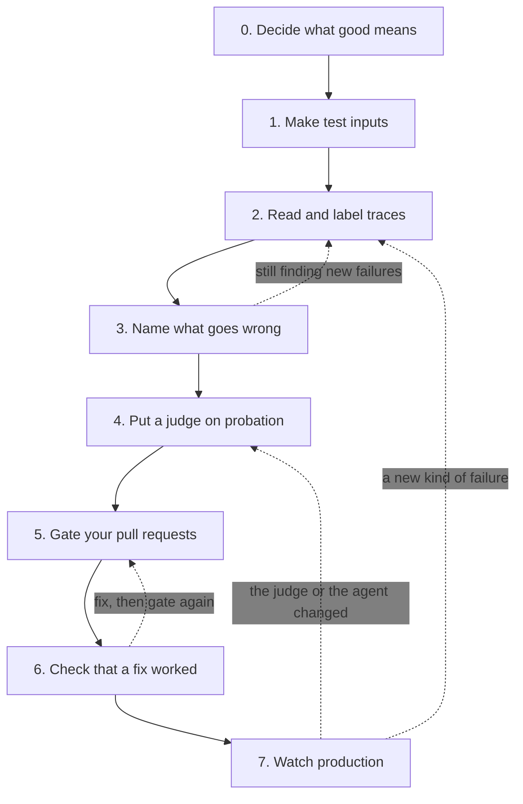

# Walkthrough

This walkthrough follows one team from their agent's first traces to a gated pull request and a
check that runs in production. Each step is one page. Every step can be run from the command line
or by asking Claude Code, and each page shows both.

## The team

A customer-support team runs OrderBot, an agent that answers order questions and issues refunds.
It looks up the order, asks a policy tool whether a refund is allowed, and then refunds or
declines. Most of the time it gets this right. The team wants to know how often it doesn't, and
they want every change to the agent checked before it ships.

OrderBot is one of the reference agents in the repository (`corpus/agents/`). Its traces are real
runs of that agent. The labels on them are synthetic: a rule that applies the store's written
return policy stands in for a human reviewer, so a large labeled set can ship with the package.
When you follow along on your own agent, the labels come from people on your team.

## The loop

<div class="diagram" markdown>



</div>

| Step | What you do | Command | What you have after it |
| --- | --- | --- | --- |
| [0. Decide what good means](define.md) | write down what a correct run is, and the situations the agent handles | `define` | a behavior spec and a grid of situations |
| [1. Make test inputs](generate.md) | collect real traces, or generate inputs and run the agent on them | `ingest`, `generate` | traces in a store, each marked as hunted or sampled |
| [2. Read and label traces](label.md) | a person reads each trace and marks it PASS or FAIL with a reason | `label` | human labels you can check a judge against |
| [3. Name what goes wrong](cluster.md) | group the failures into named kinds, and learn whether to keep looking | `cluster` | a list of failure modes, and a verdict on whether you have seen most of them |
| [4. Put a judge on probation](judge.md) | compare an LLM judge's calls with your labels before it scores anything | `calibrate`, `bias`, `judge` | a judge you are allowed to rely on, or the reason it isn't one yet |
| [5. Gate your pull requests](gate.md) | fail a build when a failure mode is too common | `run --ci` | a pass or fail on every pull request |
| [6. Check that a fix worked](improve.md) | test a fix on traces it wasn't tuned on | `improve` | evidence that the fix helped and didn't break something else |
| [7. Watch production](production.md) | score a random sample of live traffic on a schedule | `ingest --sample`, `run` | a failure rate over time, and a signal when the judge needs checking again |

Steps 0 to 4 happen once per agent, and again when the agent or its policies change. Steps 5 to 7
run continuously. The order matters: [step 2](label.md) shows what OrderBot's team missed by
guessing at failures before reading traces.

## Install

```bash
pip install "calibrated-agent-evaluation[stats,sampling,ui]"
calibrated-agent-evaluation doctor
```

`stats` runs the judge checks and the gate, `sampling` builds the grid of situations in step 0,
and `ui` serves the labeling page in step 2. `doctor` lists the extras you have and prints the
install line for any you are missing. [Install](../how-to/install.md) covers uv, a checkout, and
the other extras.

Every command reads and writes one store, `./.calibrated-agent-evaluation` unless you set
`CALIBRATED_AGENT_EVALUATION_LOCAL_ROOT` or pass `--root PATH` before the subcommand.

## Try it in five minutes

```bash
calibrated-agent-evaluation quickstart
```

<div class="wrap-output" markdown>

```text
--8<-- "fixtures/expected/docs/calibrated-agent-evaluation-quickstart.txt"
```

</div>

This seeds six traces from OrderBot and ClaimsCrew (a five-agent insurance crew) with labels
written by people, and lists the four kinds of failure those people found. Nothing has been judged
yet. Without `--root` the store goes in a new temporary directory, whose path the output prints so the next steps can use it. Delete it when you are done.

Six labels are too few to check a judge. For the judge steps, seed the larger OrderBot set:

```bash
export CALIBRATED_AGENT_EVALUATION_LOCAL_ROOT=demo
calibrated-agent-evaluation quickstart --certify
```

That writes 848 OrderBot traces, a judge in two versions, and the judge model's recorded replies,
then prints the commands to run. They replay the recorded replies, so they need no credentials.
[Step 4](judge.md) and [step 5](gate.md) walk through them.

## Your own agent

The steps use OrderBot's names. On your agent, replace them as you go:

| On these pages | On yours |
| --- | --- |
| `corpus.agents.orderbot_strands:build` | your agent's entry point, as `module:callable` |
| `traces/` | a folder of trace files your agent exported |
| `trusted_broken_policy_tool` | one of your failure modes |
| `alice`, `bob` | the two people who label |

[Connect your agent](../integrate/index.md) gets your traces into the store. To drive the steps
from Claude Code, install the skills first ([Use the Claude Code
skills](../how-to/claude-code-skills.md)). If you already evaluate the agent another way, start by
asking Claude Code to review what you have:

> Audit how we evaluate OrderBot.

The `audit-eval-pipeline` skill reads your eval scripts, judge prompts and CI config, and lists
each practice that would mislead you (a judge nobody checked used as a gate, 1-to-5 scores, a
judge's raw count reported as a rate, "10 of 10 passed" on ten traces), with the step on this site
that replaces it. Its steps read files and change nothing.

Start with [0. Decide what good means](define.md).
