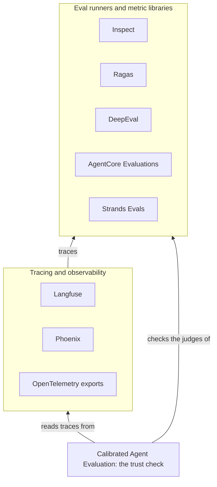

# Compared with alternatives

Most teams keep their existing tools for tracing, dashboards and metrics, and add Calibrated Agent
Evaluation for one job: deciding whether a judge's number can be trusted, and reporting the failure
rate with its uncertainty.

Claims about other tools come from their docs or installed source as read in October 2026. An
empty cell means the pages we read do not
describe the capability. That does not prove the tool lacks it, so check current docs before you
rely on a gap.

## Summary

| Capability | Inspect | Langfuse | Ragas | DeepEval | Phoenix | AgentCore Evaluations | Strands Evals | Calibrated Agent Evaluation |
|---|---|---|---|---|---|---|---|---|
| Judge checked against human labels, with an accept or refuse decision | | partial[^lf-agree] | partial[^ragas-align] | | | | | yes |
| Uncertainty on pass rates | partial[^inspect-se] | | | | | partial[^ace-ab] | | yes |
| Failure rate corrected for the judge's own mistakes | | | | | | | | yes |
| Judge bias checks (length, sycophancy, self-preference) | | | | see note[^deepeval-bias] | | | | yes |
| How many labels to collect | | | partial[^ragas-size] | | | | | yes |
| Before/after comparison of a fix | | | | | | partial[^ace-ab] | | yes, pre-registered |
| Which agent in a crew caused a failure | | | | | | partial[^ace-insights] | partial[^strands-rca] | yes, human-ratified |
| Reads OpenTelemetry traces | own log format | yes | | own tracing | yes | yes | yes | yes |

[^lf-agree]: Score Analytics compares judge scores with human annotation scores and reports Cohen's
    kappa, F1, overall agreement and a confusion matrix. It gives interpretation bands such as
    "0.61-0.80: Substantial agreement" but no accept or refuse decision and no interval.
[^ragas-align]: The judge-alignment guide reports the share of cases where the judge matches the
    human verdict, for example "121/160 passed (75.6%)", and says to stop when alignment plateaus
    or "meets your business threshold".
[^inspect-se]: Inspect's metrics report `stderr` (with clustered standard errors) and
    `bootstrap_stderr`. That is a standard error on the score, without correction for grader error.
[^ace-ab]: A/B tests on live traffic report a p-value, a confidence interval and a significance
    flag per evaluator. Batch evaluation reports `averageScore` per evaluator, and its documented
    before/after workflow subtracts two averages.
[^deepeval-bias]: DeepEval has a `Bias` metric (also offered as a managed AgentCore evaluator).
    It scores the agent's output for bias. It does not test whether the judge is biased.
[^ragas-size]: A rule of thumb: "100-200 examples covering diverse scenarios is sufficient for
    reliable alignment."
[^ace-insights]: Batch evaluation can add an insights pass that clusters failures into categories
    with per-span evidence. It is generated by a model, and it was in preview when we read it.
[^strands-rca]: Strands Evals ships a failure detector and a root-cause analyzer that run a model
    over the session and propose causes and fixes.

## Inspect AI

An evaluation framework from the UK AI Security Institute and Meridian Labs, with over 200
ready-made evaluations, sandboxed tools, the Inspect View log browser, and model-graded scorers
reported with a standard error. Whether the grader agrees with your reviewers is left to you.
Calibrated Agent Evaluation [ingests](../integrate/ingest-existing-traces.md) `.eval` logs and
[routes inputs](../integrate/route-your-agent.md) through Inspect solvers.

## Langfuse

A tracing platform with an OTLP endpoint, LLM-as-a-judge evaluators, annotation queues, and Score
Analytics for judge-human agreement. When agreement is good enough, how many annotations that takes,
and the failure rate's range are left to you. Calibrated Agent Evaluation can use Langfuse as its
trace store and write labels and scores back ([Read from Langfuse](../integrate/langfuse.md)).

## Ragas

A metrics library for retrieval, agents, tool use, SQL and text. Its judge-alignment guide is the
closest any tool here comes to calibration, but it stops at a plateau or business threshold and
sizes the sample by rule of thumb. A thresholded Ragas metric is a judge, and the Python API can
[calibrate it](../guides/calibrate-a-judge.md) with the same gate.

## DeepEval

Evaluations as pytest tests (`deepeval test run`), each metric with a pass threshold and a written
reason, plus the hosted Confident AI platform. The threshold is a fixed cut on the judge's score.
`calibrated-agent-evaluation run --ci` has the same CI shape, after the judge is certified
([Gate a PR in CI](../guides/gate-in-ci.md)).

## Arize Phoenix

Open-source tracing and evaluation over OTLP, with pre-built metrics and span annotations, which
you compare with evaluator results yourself. Calibrated Agent Evaluation reads the OpenInference
attributes Phoenix's instrumentation emits ([gallery](../integrate/gallery/index.md)).

## Amazon Bedrock AgentCore Evaluations

Scores AgentCore sessions with built-in, custom, Lambda and third-party judges, on demand, online or
in batch, and runs A/B tests on live traffic. Built-in judges have fixed prompts and models and are
not checked against your reviewers. The `agentcore` extra adds an account check
(`calibrated-agent-evaluation doctor --agentcore`), reads a runtime's traces for a time window
(`calibrated-agent-evaluation ingest --source agentcore`), and runs evaluation inputs through a
Runtime agent (`calibrated-agent-evaluation generate --run --executor agentcore`), live or from a
recorded cassette. It does not yet run AgentCore evaluators as judges; their results come in only
as advisory labels ([AgentCore](../integrate/gallery/agentcore.md)).

## Strands Evals

`strands-agents-evals` has trajectory and tool-use evaluators, user simulation, and mappers for
OpenInference, LangChain OpenTelemetry and CloudWatch sessions. Its evaluators and root-cause
analyzer are model output with no check against human labels. Calibrated Agent Evaluation drives
Strands agents and uses a model's proposed crew culprit only after a human ratifies it ([Evaluate a
crew](../guides/evaluate-a-crew.md)).

## When Calibrated Agent Evaluation is the wrong tool

- You need tracing or production dashboards. Use Langfuse, Phoenix or AgentCore.
- You need ready-made benchmarks. Inspect ships hundreds.
- You can't get any human labels. Without them a judge can't be certified and no rate is
  corrected.

## Next

- [The problem, with numbers](index.md)
- [Checking a judge](../concepts/how-the-numbers-work/checking-a-judge.md)
- [How the numbers work](../concepts/how-the-numbers-work/index.md)
