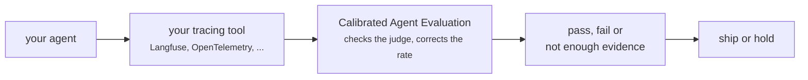

# Deciding whether to ship

Calibrated Agent Evaluation answers one question for a team shipping an AI agent: how often does it
fail, and do we have enough evidence to say? New to the terms? Start with [Agent evals in five
pictures](primer.md).

## The number your dashboard shows can be wrong

--8<-- "fixtures/expected/docs/home-value-panel.md"

## Three answers

| Answer | What it means | What your team does |
| --- | --- | --- |
| Pass | Every failure mode is under your limit, even at the cautious end of its range. | Ship. |
| Fail | At least one failure mode is over your limit, and the result names it. | Fix that failure mode, then run again. |
| Not enough evidence | The judge isn't checked yet, or there are too few traces or labels. | Collect what the refusal asks for. It gives the count. |

The limit is yours to set per build. It applies to every failure mode separately, so one bad mode
can't hide behind a good average.

## What it costs your team

| Item | Typical amount |
| --- | --- |
| Human labels to check a judge you expect to be right 90% of the time | 55 failures and 55 passes |
| Traces the judge scores for the rate | at least 150, drawn at random |
| Model spend for the judge | about $2.24 per 1,000 judge calls on the judge kit's short traces |
| Compute | seconds on a laptop |

The labels are the real cost: someone who knows what a good answer looks like has to read about
110 traces. A judge you check once can be reused until its prompt or model changes.
[What it costs you](cost.md) has the full breakdown.

## What it protects you from

- A judge that agrees with whoever pushed back last, or prefers longer answers. Both are tested
  before the judge is trusted.
- Grading the judge on the same labels twice, which lets a team tune it until it passes.
- Calling a prompt change an improvement without a before-and-after test agreed on in advance.
- A fix that moves failures from one agent in a crew to another without reducing them.

## Where it fits

It doesn't replace your tracing or dashboard tool. It reads the traces those tools already keep.
[Compared with alternatives](alternatives.md) places it next to the tools your team may use.

## Status

{N} is at version 0.1.0, before 1.0. The results on this site come from a synthetic
sample and the OrderBot sample agent; there is no production case study yet.
[Versioning and stability](../versioning.md) says what pre-1.0 means for teams adopting it.
