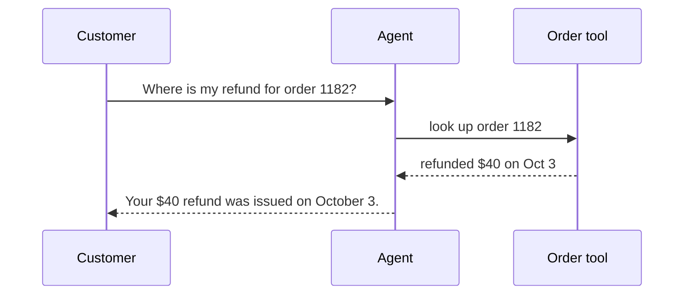
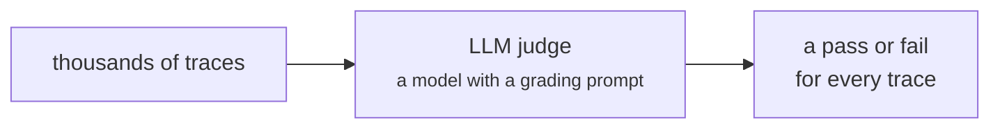

# Agent evals in five pictures

An agent eval answers one question: how often does your agent get it wrong? These five pictures
cover the words the rest of the site uses. Each term is also in the [glossary](../concepts/glossary.md).

## 1. A trace is one run, recorded

A **trace** is everything that happened in one run: the messages, each tool call, and the answer.
Your agent's tracing setup (OpenTelemetry, Langfuse, Inspect, Strands) already records them.
Calibrated Agent Evaluation reads those records without running your agent.

## 2. A label is a person's verdict

| Trace | Pass or fail | Why |
| --- | --- | --- |
| 0412 | pass | refund amount matches the order |
| 0413 | fail | trusted the policy tool when it returned an error |
| 0414 | fail | dropped the delivery date the customer asked for |
| 0415 | pass | correct order status |

A **label** is a person on your team reading a trace and marking it pass or fail, with a short
reason. Labels with the same kind of reason group into a **failure mode**, such as "trusted a broken
policy tool". `calibrated-agent-evaluation label --serve` opens a review page for this.

## 3. A judge labels the rest

People can't read every trace, so teams ask another model to grade them. That model, with its
grading prompt, is the **LLM judge**. It is fast and cheap, and it makes mistakes.

## 4. The judge's mistakes end up in the number

|  | A person says fail | A person says pass |
| --- | --- | --- |
| The judge says fail | caught | false alarm |
| The judge says pass | missed | correct |

Checking the judge means comparing its verdicts with your labels on the same traces and counting
each box. When your agent rarely fails, even a few false alarms per hundred good traces can
outnumber the real failures:

Calibrated Agent Evaluation counts those boxes on your labels, refuses a judge that gets too many
wrong, and takes the judge's measured mistakes back out of the rate.

## 5. The answer comes with a range

An answer like "6.0%, likely between 0.0% and 12.6%" means the data can't rule out anything in that range. More
labels and more scored traces narrow it.

A **CI gate** turns the range into a decision for each code change: pass, fail, or not enough
evidence to say.

## Next

- [Deciding whether to ship](leaders.md): what the library tells a team lead, and what it costs.
- [The problem, with numbers](index.md): the same story with the programs that produce it.
- [Quickstart](../getting-started/quickstart.md): run it yourself on the sample corpus.
